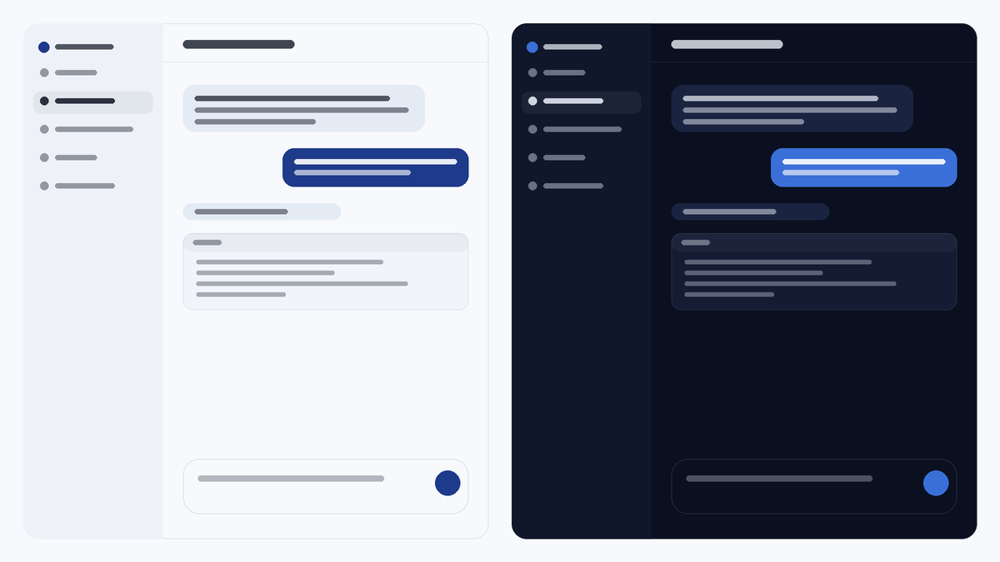

# dsh-mint-lite

一个给 **DeepSeek Harness（DSH）** 用的极轻量月光配色主题：冷白偏蓝的内容区、深海军蓝的深色模式、圆润字体，强调色一个都不动。

> 为「性能敏感」而做。DSH 主题插件常见的做法是叠壁纸层、毛玻璃、监听 DOM 重绘——这些都会持续吃 GPU 和电。这个插件反过来：**只覆盖 token、注入 1 段样式，运行时没有任何循环、监听或重绘。**



*上图为配色渲染示意，不是应用截图。*

---

## 它到底有多轻

| 项目 | 数值 |
|---|---|
| 覆盖的 theme token | **23 个**（全部 61 个 token 里只动这 23 个） |
| 注入的 `<style>` | **1 个** |
| `client.js` 体积 | 约 9 KB（未压缩） |
| 宿主侧代码 | 0 行逻辑（`apply()` 是空函数） |
| `backdrop-filter` | 无 |
| `MutationObserver` / `ResizeObserver` | 无 |
| `setTimeout` / `setInterval` / `requestAnimationFrame` | 无 |
| `localStorage` / 状态文件 / 设置面板 | 无 |
| 卸载后残留 | 无（`ctx.effect` 的 disposer 会摘掉样式和 token 层） |

## 它长什么样

配色表来自 ds-bot 的 Moonlight 主题，8 色卡：

| 键 | light | dark |
|---|---|---|
| bg | `#f7f9fc` | `#0b1020` |
| sidebar | `#eef2f8` | `#10172a` |
| bubble | `#e5ebf5` | `#1a2340` |
| bubbleHi | `#d8e2f2` | `#232f52` |
| card | `#ffffff` | `#141c33` |
| text | `#121826` | `#e8edf7` |

**实色，不是半透明。** 早先的版本用 `rgba(255,255,255,0.61)` 叠一层薄荷渐变；月光版本改成实色。原因是 ds-bot 也通过 `ctx.theme.overrideTokens` 往同一批 shell token 里写值，两层叠在一起时后注册的赢——只有两边写**完全相同的实色值**，结果才与顺序无关。

- **浅色**：冷白 `#f7f9fc` 内容区，蓝灰 `#eef2f8` 侧栏。
- **深色**：深海军蓝 `#0b1020` 内容区，`#10172a` 侧栏，卡片抬到 `#141c33`。
- **字体**：`SF Pro Rounded` / `ui-rounded`，仅浅色生效；字重靠 `-webkit-text-stroke: 0.18px` 微调（`font-weight` 最小跳档是 400→500，墨水量 +25%，太粗了）。

## 强调色一个都没改

按钮、链接、焦点环、成功/警告/错误状态色、diff 配色、品牌色、滚动条——**全部来自 DSH 原生调色板**。这个插件只碰两件事：**表面色**（底、侧栏、气泡、分层、输入框、代码块）和**文字灰阶**（primary / secondary / tertiary + 边框 4 档）。

对比度（落在实际实色背景上）：

| 用途 | light | dark |
|---|---|---|
| 正文 on bg | 16.81:1 | 16.13:1 |
| 正文 on sidebar | 15.78:1 | 15.18:1 |
| 正文 on bubble | 14.80:1 | 13.17:1 |
| 二级文字（74%） | 7.39:1 | 9.11:1 |
| 三级文字（60%） | 4.57:1 | 6.31:1 |
| 侧栏 / 内容区 | 1.07:1 | 1.06:1 |

侧栏与内容区只差一个色相台阶（1.07:1），这是月光本身的设计：靠**色温**分离，不靠明度。要更强的分界感，改 `MOON.light.sidebar` 往下压。

原生 `link` `#4176e6` 落在 `#f7f9fc` 上是 4.02:1（白底 4.23），刚好卡在 AA 边缘；深色下 `#7aaaff` 是 8.13:1，很宽裕。

## 安装

插件通过 DSH profile 的 bundle 机制加载。把仓库放到任意目录，然后在 profile 的 `package.json` 里加一行依赖：

```json
{
  "dependencies": {
    "dsh-mint-lite": "link:/绝对路径/到/dsh-mint-lite"
  },
  "dsh": {
    "profile": {
      "bundles": ["…", "dsh-mint-lite"]
    }
  }
}
```

对应 profile 目录一般是 `~/.dsh/profiles/<名字>/`。改完重启 DSH 或重载 Web UI 生效。

也可以用 `file:` 或直接解包到 `node_modules/dsh-mint-lite`。

### 和 ds-bot 一起用

两者都会往 shell token 里写值。按 bundle 顺序，ds-bot 的层覆盖本插件。本插件写的值与 ds-bot 的 Moonlight 完全一致，所以无论哪层在上，观感都一样——**前提是 ds-bot 里的团队主题也选 Moonlight**。ds-bot 切到别的主题时，它那半边会跟着变，本插件管不到。

## 切换浅色 / 深色

本插件**不注册自己的主题 id，也不存任何偏好**。浅色、深色、跟随系统走 DSH 自带的「设置 → 通用 → 外观」，由宿主的 `ui-theme.preference` 持久化。

## 想自己改

全部可调项都在 `client.js` 顶部：

| 想改什么 | 改哪里 |
|---|---|
| 整体色调 | `MOON` 那张 8 色卡（light / dark 各 6 个键） |
| 文字灰阶浓度 | `TOKENS` 里 `label-secondary` / `label-tertiary` 的 `0.74` / `0.6` |
| 边框强度 | `border-l1~l4` 的四个 alpha |
| 侧栏分界 | `MOON.*.sidebar` |
| 字体 | `FONT_ROUNDED` |
| 字重 | `STROKE`（`0.18px` ≈ +7% 墨水量，`0.30px` ≈ +13%） |
| 深色退出 | 把 `TOKENS` 每一对的 `dark` 改成 `var(--dsw-static-*)` 引用 |

## 兼容性

- 面向 DSH 的 Cordis 客户端插件接口（`window.__ModuleLoader__` + `ctx.theme.overrideTokens`）。
- 浏览器半边声明在 `package.json` 的 `dsh.client`，`inject: ["theme"]`。
- 宿主半边 `index.js` 为空——它不提供路由、不存状态，只作为 bundle 占位。

## 许可

[MIT](./LICENSE)
